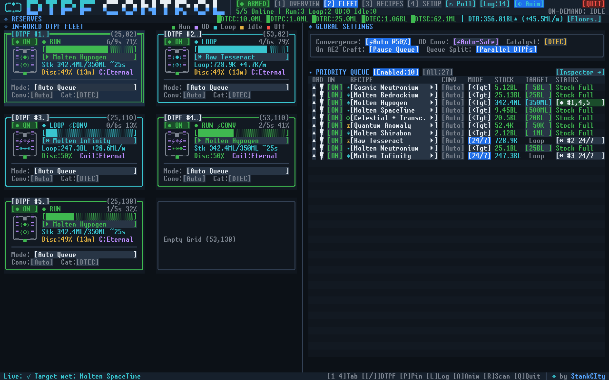
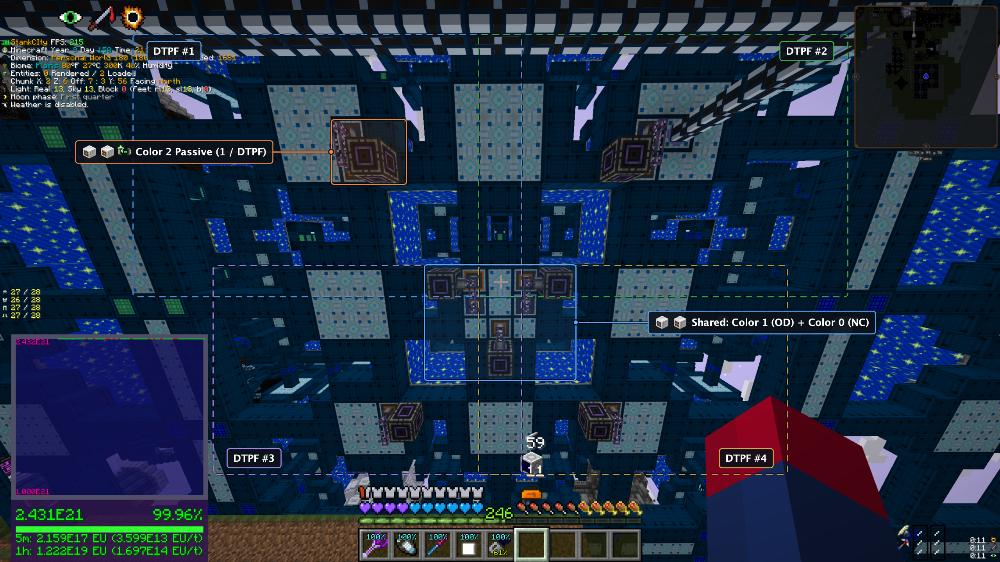
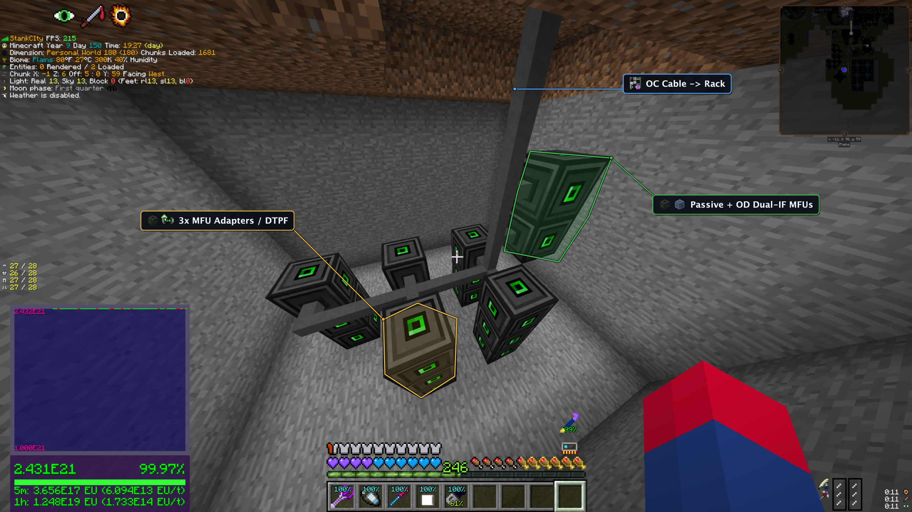
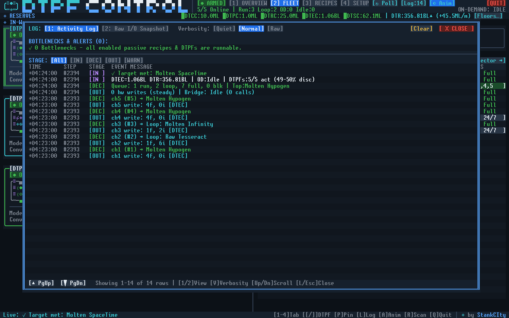

# GTNH DTPF OpenComputers Controller

Autonomous OpenComputers (`Lua 5.3`) controller for **GregTech: New Horizons (GTNH 2.9+)** Dimensionally Transcendent Plasma Forges (**DTPFs**). It dynamically dispatches passive crafting, yields cleanly to AE2 On-Demand crafts, handles catalyst ramp/convergence costs, and scales from 1 DTPF to an entire base from a single UI.

### `[1] OVERVIEW` — Global Reserves, Catalyst Tier & Active DTPFs


### `[2] FLEET` — Per-DTPF Channels, Roles & Live Status


---

## 1. How It Works (Core Concepts)

The controller keeps **Main AE2**, **On-Demand (`Color 1`)**, **Passive (`Color 2`)**, and **Non-Consumed (`Color 0`)** cleanly separated so AE2 autocrafts never fight passive production:

```text
                   +------------------------------------------------+
                   |                MAIN AE2 NETWORK                |
                   +---------+----------------------------+---------+
                             |                            |
       Pattern Dual IF       |                            |  Main Dual IF + Bi-Dir
  (Blocking + Adv. Card)     v                            v  Item & Fluid Storage Buses
                      +-------------+              +-------------+
                      |  ON-DEMAND  |              |   PASSIVE   | (0 drives: sees Main;
                      |   SUBNET    |              |   SUBNET    |  inserts flow straight
                      |  (Color 1)  |              |  (Color 2)  |  back into Main AE2)
                      +------+------+              +------+------+
                             |                            |
                      [OD Dual IF] <-> [Transposer] <-> [Passive Dual IF]
                       (+ Adapter)    (Cat Ramp &        (+ Adapter)
                                       OD -> Main)
                             |                            |
                             v                            v
  [NC Subnet (Color 0)] -> DTPF #1 .. #N <----------------+  --> Shared Outputs -> Main
  (Shared NC Input Bus)    - Shared Color 1 OD Hatch + Bus
                           - Dedicated Color 2 Hatch + Bus (autoPull=OFF)
                                   ^
                                   :  Wireless MFUs (0 OC blocks on DTPFs)
                                   v
                      [OC Server] <-- 3x MFU Adapters per DTPF
                                      (Controller + Passive Hatch + Passive Bus)
```

- **On-Demand Subnet (`Color 1`, White) — Full-Bonus Patterns:**
  AE2 patterns are encoded at the **full `50%` catalyst bonus** through a Main-to-`Color 1` Pattern `ME Dual Interface` with **`Blocking Mode: ON` + `Advanced Blocking Card`**. Whenever an AE2 craft pushes ingredients onto `Color 1`, OC detects it via an Adapter and pauses/yields passive queues so the DTPF runs the On-Demand craft immediately.
- **Passive Subnet (`Color 2`, Orange) — Bi-Directional Bridge + OC Hatch Filters:**
  Has **no storage drives of its own** and connects to Main AE2 (via an unfiltered Main `ME Dual Interface`) through unfiltered **Bi-Directional (`Extract + Insert`)** `ME Storage Bus` + `ME Fluid Storage Bus`. This exposes all Main AE2 stock to OC-filtered `Color 2` `Stocking Input Hatch/Bus (ME)` (`autoPull = OFF`) while routing anything pushed onto `Color 2` straight back into Main AE2 with zero storage feedback loops.
- **OC Transposer (`[OD Dual IF] <-> [Passive Dual IF]`):**
  Supplies startup/ramp & convergence catalyst deltas above full-bonus pattern amounts (`Passive -> OD`), drains leftover catalyst automatically when OD goes idle, and can evacuate stuck On-Demand items + fluids back through Passive into Main AE2 via **`[FLUSH OD]`** (Tab 1 `[Flush]` / Tab 4 `[FLUSH OD]`) or optional **`[AutoFlush]`** on stall.
- **Non-Consumed Aux (`Color 0`, Unpainted) & Shared Outputs:**
  All non-consumed items (Programmed Circuits, Lenses, Hypervisors, Cores, Frames/Casings) sit in a shared `Color 0` `Stocking Input Bus (ME)`, while standard `ME Output Hatch/Bus` bricks dump all products straight back into Main AE2.

---

## 2. What Each DTPF Shares vs. Needs Dedicated

Zero OC blocks or cables touch any DTPF. Every MFU (`Upgrade MF`) is bound to the front face with `Sneak + Right-Click` and placed in Adapters back in your OC room (wireless up to `512` blocks).

| Channel / Subsystem | Color | Shared Across DTPFs? | Physical AE2 / GT Hardware | OC Hardware Per DTPF |
| :--- | :--- | :--- | :--- | :--- |
| **Outputs** | Default | **Yes (Wallshared)** | Shared `ME Output Hatch` + `ME Output Bus` -> Main AE2 | `0` |
| **Non-Consumed Aux** | `Color 0` (Unpainted) | **Yes (Wallshared)** | Shared `Stocking Input Bus (ME)` holding NC catalysts/circuits/lenses | `0` |
| **On-Demand (OD)** | `Color 1` (White) | **Yes (Wallshared) or 1:1** | `Stocking Input Hatch (ME)` + `Stocking Input Bus (ME)` on `Color 1` | `0` per DTPF (`1` Adapter on OD Dual IF, or `1` per OD mini-subnet) |
| **Passive Channel** | `Color 2` (Orange) | **Dedicated per DTPF** | Dedicated `Stocking Input Hatch (ME)` + `Stocking Input Bus (ME)` (`autoPull = OFF`) | **`3` Wireless MFUs** (`1` Controller + `1` Hatch + `1` Bus) in `3` Adapters |

---

## 3. Setup Visuals

### Underside Wallsharing — Shared Outputs, Shared `Color 0` NC, `Color 1` OD & `Color 2` Passive


### AE2 Bridge Room — `Color 0` NC, `Color 1` OD Pattern IF + Transposer & Passive / Stock Dual IF


### OC Wireless MFU Room — `3` MFU Adapters per DTPF + Passive / OD Dual-IF Adapters


---

## 4. Install & First Boot

Requires **Lua 5.3** (`Sneak + Right-Click` a **Tier 3 CPU / APU Tier 3**), **`2x Memory (Tier 3.5)`**, **`HDD Tier 2 (2 MB)`**, and an **Internet Card** (or `--local` for offline/floppy installs).

```sh
wget -f https://raw.githubusercontent.com/Jimbo-Coder/gtnh-dtpf-control/main/install.lua && install
```

1. Run `dtpf` (starts **PAUSED** on fresh config so nothing runs unconfigured).
2. Open **`Tab 4 (SETUP)`** and click **`[ 1:1 PAIR DTPFS ]`** (and **`[ 1:1 PAIR OD ]`** if using separate OD subnets) — OC auto-pairs Controllers, Hatches, and Buses by 3D coordinates.
3. Verify readouts via `dtpf --check`, then click **`[ARM / RESUME]`** to begin autonomous scheduling.

Useful CLI commands:
- `dtpf` — Launch 160x50 Control Center GUI
- `dtpf --check` — Read-only hardware, AE2 stock, and scheduler dry-run check
- `dtpf --lock` — Force `autoPull = OFF` on all passive `Stocking Input Hatch/Bus (ME)`
- `dtpf --worker` — Run headless Relay Mode worker daemon on additional servers
- `dtpf --update` — Pull updates from GitHub while backing up and preserving `/home/dtpf/config.cfg`

---

## 5. OC Scaling & DTPF Limits

Because each DTPF uses `3` components in 1:1 MFU mode (Controller + Passive Hatch + Passive Bus) alongside shared adapters and system components:

| OC Hardware Tier | Component Budget | Practical DTPF Limit | How It Scales |
| :--- | :--- | :--- | :--- |
| **Tier 3 Case** | `16` components | **Up to `2` DTPFs** | Single computer case setup |
| **1x Server (Comp. Bus T3)** | `64` components | **Up to `~18` DTPFs** | Single server in a Server Rack |
| **1x Full Server Rack** | `4x 64` (Relay Mode) | **Up to `~78` DTPFs** | `1` GUI coordinator + `3` headless `dtpf --worker` servers inside one rack (enable **Relay Mode** in the Rack GUI) |
| **Multi-Rack (OC Cable)** | Unlimited racks (`port 4104`) | **`80–150+` DTPFs** | Chain extra Server Racks running headless `dtpf --worker` servers over normal OC cables; the coordinator discovers them automatically |

---

## 6. Convergence Control

Full automated Tier 2 **Catalyst Convergence** control (`isConvergence`, target catalyst / convergence tier management) uses [`DriverDTPF` (GTNewHorizons/OpenComputers#228)](https://github.com/GTNewHorizons/OpenComputers/pull/228). If that PR is not yet included in your GTNH build, the controller still installs cleanly and falls back gracefully to standard Tier 0/1 scheduling with read-only convergence visibility where supported.

---

## 7. Logs, Tooling & Docs



- **[DESIGN.md](DESIGN.md)** — Full hardware layout, Transposer bridge & OD flush details, scheduler math, catalyst policy, and multi-rack protocol details.
- **`tools/test_offline.py`** — Offline Lua 5.3 + JNLua heap & UI test suite.
- **`tools/extract_dtpf_recipes.py`** — GTNH recipe extractor feeding `lib/recipes_db.lua`.
- **License:** [MIT](LICENSE)
