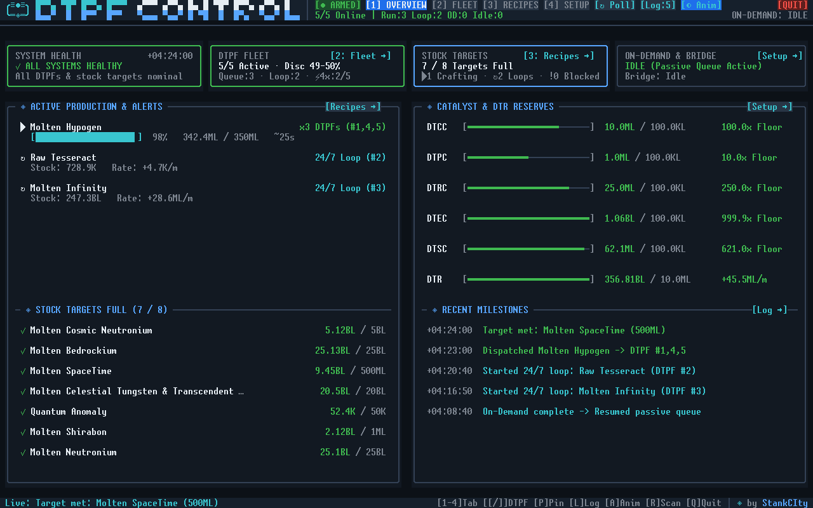
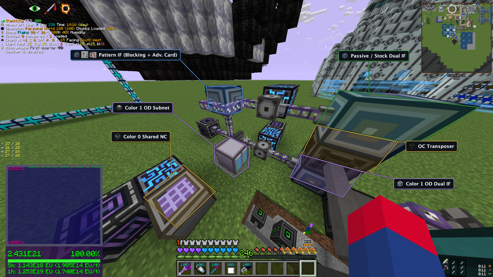

# GTNH DTPF OpenComputers Controller

Autonomous OpenComputers (`Lua 5.3`) controller for **GTNH 2.9+** Dimensionally Transcendent Plasma Forges (**DTPFs**). Developed with AI—feel free to use, iterate, and adapt it to your needs. Contributions are welcome.

## Working Concept

Every DTPF uses **two colored ME Stocking Input Bus/Hatch channels** (plus one shared Non-Consumed bus):
- **Passive channel (lower-priority color, `autoPull = OFF`):** Sees your entire Main AE2 stock; OpenComputers rewrites each DTPF's input bus/hatch filters on the fly to run passive stock targets or 24/7 discount loops.
- **On-Demand channel (higher-priority color, `autoPull = ON`):** Sits empty until Main AE2 pushes a craft into the OD subnet—immediately superseding passives to run that craft (topping up ramp/convergence catalyst via transposer if needed) before handing the DTPF back.




---

## Why This Setup

DTPFs want 24/7 looping recipes to hold their `50%` fuel discount, prioritized passive stock targets with both input and output thresholds so expensive crafts don't drain your AE2 dry, and instant yielding to on-demand crafts. Doing all of that manually with colored hatches and redstone across many recipes and DTPFs turns into a circuit mess and hits hatch/bus count limits fast.

This turns every DTPF into a **Universal DTPF** with minimal AE2 wiring: all DTPFs share the passive workload, respect input/output reserve floors, and swap to On-Demand automatically—configured in one click from a central screen.

### Recommended OpenComputers Tweaks (Optional)
Everything works on stock GTNH 2.9+, though two optional tweaks make the experience much smoother:
- **Auto Convergence PR:** [`GTNewHorizons/OpenComputers#228`](https://github.com/GTNewHorizons/OpenComputers/pull/228) (`DriverDTPF`) lets OC toggle **Catalyst Convergence** automatically (falls back gracefully without it).
- **`config/OpenComputers.cfg` QoL settings:**
  - `mfuRange=512` *(default `16`)* — Wireless MFUs reach all DTPFs with zero OC cable in your machine room.
  - `callBudgets=[1.5, 3, 4.5]` *(default `[0.5, 1, 1.5]`)* — `3×` component/GPU calls per tick for instant UI redraws and hatch updates.
  - `executionDelay=4` *(default `12`)* — Snappier UI touch/key response.
  - `transposerFluidTransferRate=65536` *(default `2560`)* — Fast (`65.5 kL/s`) catalyst ramp top-ups and OD flushes.

---

## Hardware Setup (2 + 1 Subnets)

```text
                   +----------------------------------------+
                   |            MAIN AE2 NETWORK            |
                   +-------+------------------------+-------+
     Pattern Dual IF       |                        |  Main Dual IF + Bi-Dir
  (Blocking + Adv Card)    v                        v  Item & Fluid Storage Buses
                    +-------------+          +-------------+
                    |  ON-DEMAND  |          |   PASSIVE   | (0 drives)
                    | (High Prio) |          | (Low Prio)  |
                    +------+------+          +------+------+
                           |                        |
                     [OD Dual IF] <-> [Transposer] <-> [Passive Dual IF]
                      (+ Adapter)                      (+ Adapter)
                           |                        |
                           v                        v
[NC ME Chest] ------> DTPF #1..#N <-----------------+  --> Shared Outputs -> Main
(Shared NC Bus)       - Shared OD Hatch+Bus (autoPull=ON)
                      - 1x Passive Hatch+Bus per DTPF (autoPull=OFF)
                      - 3x Wireless MFU Adapters per DTPF -> [OC Server]
```

### 1. DTPFs (Quad Wallsharing)
- **Shared at the 4-way center corner:** `1` Output Hatch/Bus pair (→ Main AE2), `1` OD Stocking Hatch/Bus pair (high-priority color like black/white, `autoPull = ON`), and `1` NC Stocking Bus (`autoPull = ON`).
- **Dedicated per DTPF:** `1` Passive Stocking Hatch/Bus pair (any lower-priority color, **`autoPull = OFF`**). *(Sharing passive channels also works if desired, though 1:1 gives per-DTPF recipe control.)*


### 2. Subnets
- **On-Demand (OD) Subnet:** Main-net `ME Dual Interface` (**Blocking Mode** + **Advanced Blocking Card**, same-recipe insert enabled) kissing an OD interface with storage drives. Encode OD patterns at maximal (`50%`) catalyst discount.
- **Passive Subnet:** Bi-directional (`Insert + Extract`) `ME Storage Bus` + `ME Fluid Storage Bus` kissing an unfiltered Main-net `ME Dual Interface`. Needs **zero drives**—it reads Main AE2 directly, and anything inserted (excess ramp catalyst or flushed OD items/fluids) flows straight back into Main AE2.
- **Non-Consumed (NC) Subnet:** Standalone `ME Chest` holding all non-consumables (circuits, lenses, hypervisors, cores, frames/casings) wired to the shared NC Stocking Bus. Doesn't connect to OC or Main AE2.



### 3. OpenComputers & Scaling
- **`3` Wireless MFU Adapters per DTPF** (`Upgrade MF`, `Sneak + Right-Click` the front face of: **Controller**, **Passive Bus**, and **Passive Hatch**).
- **`2` Subnet Adapters + Optional Transposer:** `1` Adapter on an OD `ME Dual Interface` and `1` on a Passive `ME Dual Interface`, with an optional **Transposer** sandwiched between them (any two faces) to top up extra catalyst during discount ramp-up/convergence and drain excess back to Main AE2.


- **`18` DTPFs per Tier 3 Server:** `16` (CPU/APU T3) + `3×16` (Component Bus T3) = `64` max components (`~9.5` used by EEPROM, GPU, screen, keyboard, cards, drives, 2 DI adapters, and transposer -> `54` left for `18×3` DTPFs).
- **`78` DTPFs per Full Rack:** Add up to `3` headless servers (`dtpf --worker`) with Network Cards and route each server's cable to its own face in the Rack GUI (`~3.5` overhead -> `20` DTPFs per worker, `18 + 3×20 = 78`).
- **`+80` DTPFs per Extra Rack:** Enable **Relay Mode** in the Rack GUI and chain 4-worker racks over OC cable (`4×20` per rack).

---

## Install, Update & Config Preservation

**Server parts:** Tier 3 Server (`3x Component Bus T3`), **APU Tier 3** (or CPU T3 + GPU T3), `2x Memory (Tier 3.5)`, `HDD Tier 2`, `EEPROM (Lua BIOS)`, and an **Internet Card** (`install --local <dir>` supported offline). **`Sneak + Right-Click` the CPU/APU in hand first so it says `Lua 5.3`**, then boot OpenOS:

```sh
# Fresh install:
wget -f https://raw.githubusercontent.com/Jimbo-Coder/gtnh-dtpf-control/main/install.lua && install

# Optional — auto-launch on world/server reboot (`dtpf --worker` on headless workers):
echo dtpf >> /home/.shrc

# Update anytime (keeps your config safe):
dtpf --update
```

- **Safe updates & config preservation:** `dtpf --update` (and re-running `install`) downloads into `.tmp` files and syntax-checks every Lua module before replacing live code. It **never overwrites `/home/dtpf/config.cfg`** and automatically mirrors a backup to `/home/config.dtpf.bak`—even if `/home/dtpf` is wiped and reinstalled, your pairings, targets, and reserve floors are restored automatically.

---

## How to Use

Run `dtpf` to open the UI. Fresh installs start **`[PAUSED]`** (read-only preview, zero hardware writes) until armed; `dtpf --lock` forces `autoPull = OFF` on all passive hatches/buses, and `dtpf --check` prints a terminal dry-run.

1. **Pair hardware (`[4] SETUP`):** Verify `Stock AE2 Interface` points to your Passive DI (main-net counts) and `On-Demand Subnet` points to your OD DI (`0` when idle), check transposer `[P:...]` / `[OD:...]` faces if used, set catalyst/DTR reserve floors, and click **`[ 1:1 PAIR DTPFS ]`** (auto-pairs every DTPF, bus, and hatch by 3D coordinates).
2. **Pick recipes (`[3] RECIPES` / `[2] FLEET`):** Enable (`[ON]`) and order your recipes. Use `[<Tgt]` with a target stock amount for normal passives, and set **`[24/7]`** on 1–2 cheap DTR-positive recipes near the bottom (e.g. Raw Tesseract, Molten Infinity) to hold `50%` fuel discount when targets are full. Variants, catalyst tiers, and input guard floors can be set per recipe in `[3] RECIPES`.
3. **Arm (`[1] OVERVIEW`):** Click `[PAUSED]` → **`[ARMED]`**. DTPFs split across needy targets, drop into 24/7 loops when full, and yield automatically whenever an OD craft arrives.
4. **Expand & maintain:** New DTPFs only need 3 more MFU adapters + `R` (or `[ 1:1 PAIR DTPFS ]`). If a cancelled OD craft leaves stray items/fluids in OD, click **`[Flush]`** (Overview) or **`[FLUSH OD]`** (Setup) to push them back to Main AE2. Press `Q` to quit cleanly back to OpenOS.

---

## Reference
- **[DESIGN.md](DESIGN.md)** — Detailed architecture, Transposer/OD-flush state machine, scheduler math, and multi-rack protocol.
- **`tools/test_offline.py`** / **`tools/extract_dtpf_recipes.py`** — Offline Lua 5.3 + JNLua test suite (`20` suites) and recipe DB extractor.
- **License:** [MIT](LICENSE)
